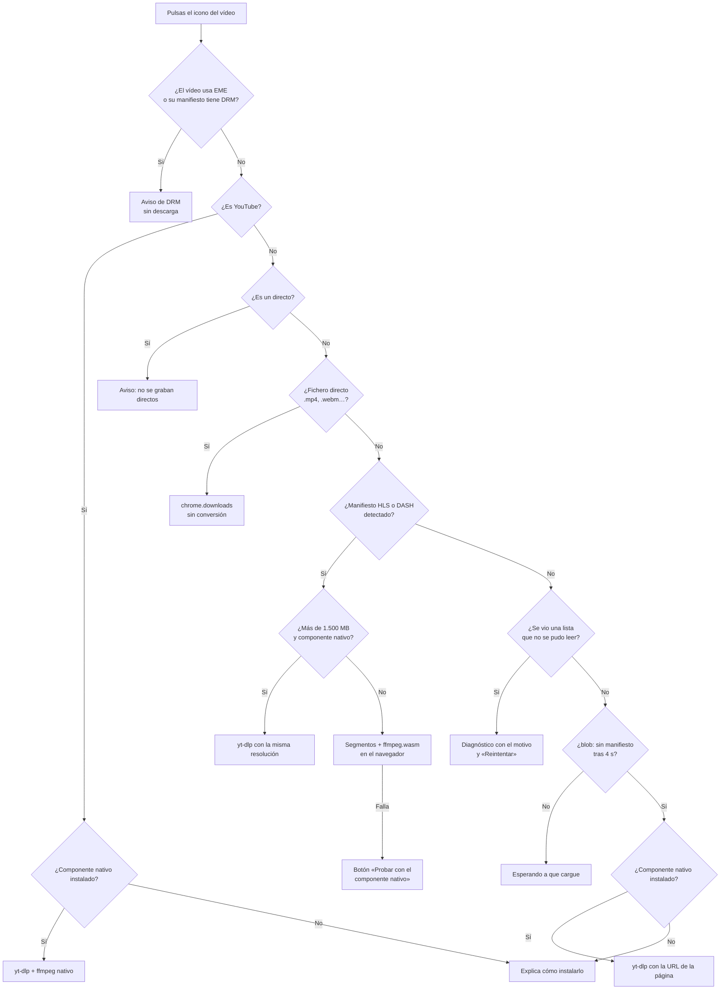

# video-down

Extensión de Chrome para **Windows y macOS** que detecta los vídeos de la página que estás viendo,
pinta un pequeño icono de descarga en la **esquina superior izquierda de cada vídeo** y, al pulsarlo,
muestra las **resoluciones disponibles**. Al elegir una, la descarga empieza en el acto.

Si el vídeo está protegido con **DRM**, la extensión lo advierte y **no lo descarga**.

> Proyecto de uso privado. No se publica en la Chrome Web Store.

---

## Índice

1. [Cómo se usa](#cómo-se-usa)
2. [Las vías de descarga: toda la casuística](#las-vías-de-descarga-toda-la-casuística)
3. [Diagrama de decisión](#diagrama-de-decisión)
4. [Qué hace cada pieza: navegador, ffmpeg, Python, Deno y yt-dlp](#qué-hace-cada-pieza-navegador-ffmpeg-python-deno-y-yt-dlp)
5. [Arquitectura y ficheros](#arquitectura-y-ficheros)
6. [Instalación en Windows y en macOS](#instalación-en-windows-y-en-macos)
7. [Por qué el instalador no puede activar la extensión él solo](#por-qué-el-instalador-no-puede-activar-la-extensión-él-solo)
8. [Seguridad](#seguridad)
9. [Ajustes](#ajustes)
10. [Desarrollo](#desarrollo)
11. [Limitaciones conocidas](#limitaciones-conocidas)
12. [Créditos y licencias](#créditos-y-licencias)

---

## Cómo se usa

1. Abre una página con un vídeo. En su esquina superior izquierda aparece un icono redondo de descarga.
   Si el vídeo tiene DRM, el icono es un candado.
2. Pulsa el icono. Se abre un menú con las resoluciones disponibles, con su códec y su tamaño aproximado
   cuando se conocen.
3. Pulsa una resolución. La descarga empieza y su progreso se ve en el propio menú, en un anillo alrededor
   del icono y en la lista del botón de video-down de la barra de Chrome.

El fichero se guarda en la carpeta de descargas de Chrome. En las opciones se puede pedir que Chrome
pregunte dónde guardar cada descarga.

Si un vídeo no sale como esperabas (faltan calidades, no se encuentra…), el enlace «Informe de
diagnóstico» al pie del menú cuenta qué ha visto la extensión en esa pestaña. Ver el
[caso 11](#informe-de-diagnóstico).

---

## Las vías de descarga: toda la casuística

La extensión tiene **dos motores** y elige uno según lo que encuentra:

- **Motor del navegador.** Todo ocurre dentro de Chrome, sin instalar nada aparte.
- **Componente nativo.** Un programa pequeño instalado en el ordenador que usa **yt-dlp**.
  Solo se usa cuando el navegador no basta.

La regla que sigue siempre es la misma: usar el motor del navegador cuando es suficiente,
y el componente nativo solo cuando hace falta. Si el componente nativo no está instalado,
la extensión nunca se bloquea: usa el navegador si puede, o explica qué falta.

### Tabla resumen

| # | Lo que hay en la página | Vía | Cómo se descarga | Resoluciones que ofrece | Requisitos |
|---|---|---|---|---|---|
| 1 | Fichero de vídeo normal: `<video src="….mp4">`, `.webm`, `.mov`, `.ogv`… | Navegador | Descarga directa con el gestor de descargas de Chrome. Ni se toca ni se convierte. | Una por cada `<source>` del vídeo. El tamaño se averigua con una petición `HEAD`. | Ninguno |
| 2 | Streaming **HLS** (`.m3u8`) sin cifrado o con AES-128 | Navegador | Se bajan los segmentos, se descifran si hace falta, y **ffmpeg.wasm** los une en un MP4 sin recodificar. | Una por cada variante del *master playlist* (1080p, 720p…), con tamaño estimado. Si la página solo pidió una calidad, se busca la master junto a ella. | Ninguno |
| 3 | Streaming **DASH** (`.mpd`) sin DRM | Navegador | Se bajan por separado los segmentos de vídeo y de audio, y **ffmpeg.wasm** los mezcla en un MP4. | Una por cada `Representation` de vídeo. El audio se añade solo. | Ninguno |
| 4 | **YouTube** (vídeos, Shorts y vídeos incrustados) | Componente nativo | yt-dlp obtiene los formatos y los descarga. El ffmpeg instalado une vídeo y audio en un MP4. | Todas las de YouTube (144p a 4K u 8K), con preferencia por H.264 cuando existe. | Componente nativo |
| 5 | Reproductor con **formato propio** (`<video src="blob:…">` sin manifiesto HLS ni DASH reconocible) | Componente nativo | yt-dlp reconoce más de 1.000 sitios (Vimeo, Twitch, TikTok, Instagram, X…) y descarga con su extractor. | Las que ofrezca el sitio. | Componente nativo |
| 6 | HLS o DASH de **más de 1,5 GB** (límite configurable) | Componente nativo si está instalado; si no, navegador | yt-dlp descarga el mismo manifiesto con la misma resolución. Se evita así el límite de memoria de ffmpeg.wasm. | La misma que elegiste en el menú. | Componente nativo (recomendado) |
| 7 | La descarga en el navegador **falla** (token del CDN, cabeceras raras…) | Componente nativo, a petición tuya | En el mensaje de error aparece «Probar con el componente nativo». | Las que encuentre yt-dlp. | Componente nativo |
| 8 | Vídeo con **DRM** (Widevine, PlayReady, FairPlay, ClearKey) | Ninguna | Se muestra el aviso y no se ofrece descarga. | — | — |
| 9 | Emisión **en directo** | Ninguna en esta versión | Se avisa de que no se graban directos. | — | — |
| 10 | Vídeo que todavía no ha empezado a cargar | Espera | El menú dice «Esperando a que el vídeo empiece a cargar» y se actualiza solo. | — | — |
| 11 | Lista detectada que no se puede leer (página de error, formato propio cifrado, o un enlace que caducó sin que el reproductor llegara a leerlo) | Ninguna, con diagnóstico | El menú explica el motivo exacto y ofrece «Reintentar»; si procede, también probar con yt-dlp. Un enlace de un solo uso que el reproductor sí leyó ya no llega aquí: se usa su copia (caso 2). | — | — |

### Caso 1. Fichero de vídeo directo

- **Cuándo.** El `<video>` apunta a un fichero normal, o tiene varios `<source>` con distintas calidades.
- **Qué pasa.** El service worker pide a Chrome que descargue la URL con `chrome.downloads`.
  Es exactamente lo mismo que pulsar «Guardar vídeo como…».
- **Resoluciones.** Una entrada por cada `<source>`. La etiqueta sale de sus atributos `label`, `size`,
  `res`, `data-quality` o `title`. Si no los hay, de la altura real del vídeo que se está reproduciendo.
- **Conversión.** Ninguna. El fichero llega tal cual lo sirve la web.

### Caso 2. HLS (`.m3u8`)

- **Cuándo.** El reproductor (hls.js, Video.js, JW Player, el reproductor nativo de Chrome…) pide un
  manifiesto. La extensión lo reconoce de tres formas, por este orden:
  1. por la URL, si termina en `.m3u8`;
  2. por el tipo de contenido de la respuesta (`application/vnd.apple.mpegurl` y similares), aunque la URL
     no diga nada;
  3. por su contenido: si una respuesta de texto que pidió la página empieza por `#EXTM3U`, es una lista HLS
     aunque se sirva como `text/plain` y sin extensión. Esto lo hace un script dentro de la página, y la
     extensión solo acepta la URL que informa tras comprobar que la página la pidió de verdad.
- **La copia del reproductor.** Ese mismo script guarda el texto completo de cada lista tal como lo
  recibió el reproductor. Si la extensión no puede volver a leerla (enlace de un solo uso, token que
  caduca en segundos, CDN que solo responde al reproductor), las calidades salen de esa copia.
- **Listas pedidas por un service worker de la página.** Esas peticiones no pertenecen a ninguna pestaña.
  La extensión las apunta por el origen del service worker y acepta lo que informe el script de la página
  si coincide ese origen.
- **Resoluciones.** Se lee el *master playlist* y se ofrece una entrada por variante de vídeo.
  El tamaño se estima con el `BANDWIDTH` declarado y la duración del vídeo.
- **Cuando la página solo pide una calidad.** Algunos reproductores reciben una sola variante, o leen la
  master de una forma que la extensión no ve. Entonces se busca la master donde la dejan los empaquetadores
  habituales, sin listas de sitios:

  | Empaquetador o costumbre | Variante que pide la página | Master que se prueba |
  |---|---|---|
  | Unified Streaming | `nombre-audio_eng=128000-video_eng=2000000.m3u8` | `nombre.m3u8` |
  | Wowza | `chunklist_w123_b800000.m3u8` | `playlist.m3u8` |
  | nginx-vod, Kaltura | `index-v1-a1.m3u8` | `master.m3u8` |
  | Codificadores con sufijo | `nombre_720p.m3u8` | `nombre.m3u8` |
  | Una carpeta por calidad | `…/720p/index.m3u8` | `…/master.m3u8`, `…/playlist.m3u8` |

  Se hacen como mucho cuatro intentos, con el mismo token que la variante, y solo se acepta una master
  que incluya la lista que se está reproduciendo. Las calidades de esa master heredan el token si no
  traen uno propio. Un intento fallido no se muestra como error: es una suposición, no un fallo de la página.
- **Descarga.** Los segmentos (`.ts` o fMP4) se descargan en paralelo, con reintentos, y se guardan
  en IndexedDB. Si van cifrados con **AES-128** (clave pública publicada en el propio manifiesto, que no es
  DRM), se descifran con WebCrypto, siguiendo el estándar: si la lista no declara vector de inicialización,
  se usa el número de secuencia de cada segmento. La clave se pide una sola vez.
- **Vídeo en un único fichero.** Si la lista usa rangos de bytes (`EXT-X-BYTERANGE`), cada segmento se
  pide como un trozo del fichero con una petición `Range`.
- **Montaje.** En un documento oculto de la extensión (*offscreen document*) se carga **ffmpeg.wasm**,
  que une los segmentos en un MP4 copiando los flujos, **sin recodificar**. Si el audio va en una pista
  aparte, se mezcla en el mismo paso.
- **Guardado.** El MP4 se entrega a `chrome.downloads`.
- **Respaldo automático.** Si algo falla en el navegador y el componente nativo está instalado, la misma
  descarga continúa sola con yt-dlp y el ffmpeg nativo; el menú lo indica.
- **Master que ya no se puede leer.** Con la calidad elegida, la descarga va directa a ella aunque la
  master no responda una segunda vez.
- **Reproductores incrustados y CDN que comprueban quién pide.** Es muy habitual que el vídeo esté en un
  `<iframe>` de otro sitio (plataformas de cursos, alojadores de vídeo) y que su CDN solo responda si la
  petición lleva el `Origin` y el `Referer` de ese reproductor. La extensión hace lo mismo que el reproductor,
  en cualquier web y sin listas de sitios:
  - lee los manifiestos primero desde el propio marco del reproductor, con su origen;
  - cuando lee o descarga desde el service worker, añade el `Origin` y el `Referer` del marco que reproduce
    el vídeo mediante reglas temporales de `declarativeNetRequest`, y envía las cookies del sitio;
  - esas reglas cubren todos los servidores que aparecen en las listas (manifiesto, variantes, segmentos y
    claves, aunque estén en CDN distintos), solo afectan a peticiones de la propia extensión y se borran al
    terminar.

### Caso 3. DASH (`.mpd`)

- **Cuándo.** El reproductor (dash.js, Shaka Player…) pide un `.mpd` o algo servido como
  `application/dash+xml`.
- **Resoluciones.** Una por cada `Representation` de vídeo, con tamaño estimado (vídeo + audio).
- **Descarga y montaje.** Igual que HLS, pero el vídeo y el audio siempre van separados.
  ffmpeg.wasm los mezcla en un MP4 sin recodificar.

### Caso 4. YouTube

- **Por qué no va por el navegador.** Se comprobó el 12/10/2026 con un navegador real: el reproductor
  web de YouTube ya no publica URL descargables. Solo usa **SABR**, un protocolo propio de peticiones
  POST con cuerpo binario, protegido además con *tokens* anti-bots (PO Token) y retos de JavaScript.
  Reimplementarlo en la extensión sería frágil y se rompería cada pocas semanas.
- **Qué se hace.** Se pasa la URL canónica del vídeo (`https://www.youtube.com/watch?v=…`, también para
  Shorts e incrustados) al componente nativo. yt-dlp, mantenido por una comunidad muy activa, resuelve
  esos retos con ayuda de Deno.
- **Resoluciones.** Una por altura (2160p, 1440p, 1080p60…). Para cada una se prefiere **H.264** cuando
  existe, porque lo reproduce todo, incluido QuickTime en Mac. Por encima de 1080p YouTube solo da VP9
  o AV1, y se indica en el menú.
- **Montaje.** YouTube entrega vídeo y audio por separado. El **ffmpeg instalado** los une en un MP4.
- **Sin componente nativo.** El menú lo explica y enlaza a las instrucciones de instalación.

### Caso 5. Reproductores con formato propio

- **Cuándo.** El vídeo usa `blob:` (Media Source Extensions) y pasados 4 segundos no ha aparecido ningún
  manifiesto HLS ni DASH que la extensión sepa leer. Es lo habitual en redes sociales y plataformas grandes.
- **Qué se hace.** Se pasa la URL de la página a yt-dlp. Si el reproductor está dentro de un `<iframe>`
  (por ejemplo, un Vimeo incrustado), se envía también la página que lo contiene como `Referer`,
  porque muchos de esos reproductores lo exigen.

### Caso 6. Ficheros muy grandes

ffmpeg.wasm trabaja en la memoria del navegador y falla por encima de unos 2 GB. Por eso, cuando el
tamaño estimado supera **1.500 MB** (se cambia en las opciones) y el componente nativo está instalado,
la descarga pasa a yt-dlp con la misma resolución. Si no está instalado, se intenta en el navegador.

### Caso 7. Respaldo manual

Si una descarga de HLS o DASH falla en el navegador y el componente nativo está instalado, el mensaje de
error ofrece «Probar con el componente nativo».

### Caso 8. DRM

- **Cómo se detecta.**
  - Un script que corre dentro de la página vigila las *Encrypted Media Extensions* (EME): si un `<video>`
    recibe claves (`setMediaKeys`) o datos de cifrado (evento `encrypted`), queda marcado con su sistema.
  - En los manifiestos: claves `SAMPLE-AES`, Widevine, PlayReady o FairPlay en HLS, y elementos
    `ContentProtection` o `cenc:pssh` en DASH.
  - En el componente nativo: yt-dlp marca los formatos protegidos y se descartan.
- **Qué se hace.** El icono pasa a ser un candado y el menú muestra el aviso. No se ofrece ninguna
  resolución.
- **Por qué no se descarga «bajo responsabilidad del usuario».** Sin eludir la protección solo se
  obtendrían ficheros cifrados que no se pueden reproducir. Eludirla es ilegal en España (artículo 196 de la
  Ley de Propiedad Intelectual) y en la UE (artículo 6 de la Directiva 2001/29/CE), **aunque se tengan
  derechos sobre la obra**. Se decidió avisar y no descargar.

### Caso 9. Directos

Las emisiones en directo se reconocen (HLS sin `#EXT-X-ENDLIST`, DASH `type="dynamic"`, directos de
YouTube) y se avisa de que esta versión no las graba. El código de grabación heredado de Media Bridge
sigue en el repositorio para una versión futura.

### Caso 10. Varios vídeos en la misma página

Cada `<video>` tiene su propio icono. Como un `blob:` no dice de qué manifiesto viene, la extensión
asocia cada manifiesto al vídeo que empezó a cargar más cerca en el tiempo. Si no lo puede saber,
ofrece todos los manifiestos detectados en ese marco.

**Cambios de dirección y webs de una sola página.** Que la dirección cambie no significa que haya otro
vídeo: muchas páginas reescriben la suya mientras el mismo vídeo sigue sonando, para quitar un token o
apuntar el minuto. Por eso las listas detectadas solo se descartan cuando, tras un cambio de dirección,
un reproductor vuelve a cargar. Entonces se descarta lo que estaba asociado a ese reproductor y se pidió
antes del cambio. El script de la página avisa del cambio al instante, cuando se hace con la API History;
cualquier otro se nota con una comprobación cada segundo.

### Caso 11. El vídeo se encuentra, pero no se puede leer

A veces la extensión ve pasar la lista del vídeo, pero al leerla no obtiene una lista válida. En ese caso
el menú no se queda esperando ni pasa la página a yt-dlp a ciegas: explica el motivo exacto y muestra la
lista detectada (servidor y ruta, nunca los tokens de la URL).

| Lo que pasó | Lo que dice el menú | Qué se puede hacer |
|---|---|---|
| El servidor rechaza la lectura (HTTP 401, 403…) y el reproductor no llegó a leerla | Rechazo con su código | El enlace puede haber caducado: dale al play y pulsa «Reintentar». Si el componente nativo está instalado, también se ofrece probar con yt-dlp. |
| El servidor devuelve una página web o datos JSON | Página o datos en lugar de la lista | Suele indicar sesión o enlace caducados. «Reintentar». |
| La lista no es HLS ni DASH estándar (bytes cifrados o formato propio) | Lista cifrada o en formato propio | Nada: es una protección de la plataforma y video-down no la rompe, igual que con el DRM. |
| No hay conexión con el servidor | Error de conexión | «Reintentar». |

«Reintentar» vuelve a leer las listas que fallaron. Además, si el reproductor vuelve a pedir la misma lista
con un token nuevo, la extensión adopta automáticamente la URL más reciente.

### Informe de diagnóstico

Cuando un vídeo no sale como se esperaba, el informe dice qué ha visto la extensión en esa pestaña, sin
abrir las herramientas de desarrollo. Se abre desde el enlace **«Informe de diagnóstico»** al pie del menú
del vídeo, o desde el botón **«Diagnóstico»** del popup. Tiene un botón para copiarlo.

Contiene, por orden de tiempo:

- la versión de la extensión, el sistema, el navegador y el estado del componente nativo;
- los marcos de la página que han tenido actividad de vídeo;
- cada lista HLS o DASH que pidió la página: desde qué marco o desde un service worker, el código HTTP y el
  tipo de contenido;
- las listas que el reproductor leyó y la extensión aceptó;
- lo que concluyó cada marco: master con cuántas variantes, variante de una master, lista suelta, master
  encontrada junto a una variante, fallo de lectura con su motivo, cambio de dirección, recarga del
  reproductor y qué ofreció el menú.

Las direcciones van con servidor y ruta, **sin parámetros**: nunca incluye tokens ni firmas. El informe se
guarda en la memoria de sesión del navegador, se borra al recargar la pestaña o cerrar Chrome, y nunca
sale del equipo salvo que lo copies tú.

---

## Diagrama de decisión



---

## Qué hace cada pieza: navegador, ffmpeg, Python, Deno y yt-dlp

| Pieza | Dónde vive | Para qué se usa | Cuándo interviene |
|---|---|---|---|
| **Gestor de descargas de Chrome** (`chrome.downloads`) | Chrome | Guardar ficheros en disco | Siempre que descarga el navegador (casos 1, 2 y 3) |
| **ffmpeg.wasm** 0.12.10 | Dentro de la extensión (≈30 MB, WebAssembly) | Unir segmentos HLS o DASH y mezclar audio y vídeo en MP4, sin recodificar | Casos 2 y 3 |
| **yt-dlp** | Componente nativo (`bin/yt-dlp.exe` o `bin/yt-dlp`) | Extraer formatos y descargar de YouTube y de más de 1.000 sitios | Casos 4, 5, 6 y 7 |
| **Python** | **No hay que instalarlo.** El ejecutable oficial de yt-dlp lleva su propio intérprete dentro. | — | — |
| **ffmpeg nativo** 9.0.2 | Componente nativo (`bin/ffmpeg`) | Lo usa yt-dlp para unir vídeo y audio | Casos 4 a 7 |
| **Deno** 2.9.7 | Componente nativo (`bin/deno`) | 1) Ejecuta el componente nativo (`host.ts`) con permisos limitados. 2) yt-dlp lo usa para resolver los retos de JavaScript de YouTube. | Casos 4 a 7 |

Son **dos ffmpeg distintos**: ffmpeg.wasm va dentro de la extensión y funciona sin instalar nada;
el ffmpeg nativo solo existe si se ha instalado el componente nativo.

### Cómo habla la extensión con el componente nativo

1. La extensión abre una conexión de *native messaging* con `dev.marianogutierrez.videodown`.
2. Chrome busca ese nombre en el registro de Windows (`HKCU\Software\Google\Chrome\NativeMessagingHosts`)
   o en `~/Library/Application Support/Google/Chrome/NativeMessagingHosts/` en Mac.
   Ahí encuentra el lanzador que dejó el instalador.
3. El lanzador (`video-down-host.cmd` o `video-down-host.sh`) arranca Deno con permisos explícitos:
   solo puede leer su propia carpeta, escribir en sus subcarpetas de trabajo y ejecutar yt-dlp.
4. `host.ts` recibe un mensaje JSON validado (`ping`, `probe`, `download` o `update`), lanza yt-dlp
   y devuelve el progreso.
5. Cada operación es un proceso aparte. Cancelar una descarga cierra la conexión, y el componente
   detiene yt-dlp y borra sus ficheros temporales.

---

## Arquitectura y ficheros

```
video-down/
├─ extension/                 Extensión de Chrome (TypeScript + Vite, Manifest V3)
│  ├─ manifest.json           Permisos, scripts y la clave pública que fija el ID de la extensión
│  ├─ scripts/build.mjs       Compilación en tres pasadas (páginas y service worker, content script, script de página)
│  ├─ public/_locales/        Textos en castellano e inglés
│  └─ src/
│     ├─ service-worker.ts    Coordina: red, descargas, componente nativo y progreso
│     ├─ content.ts           Detección por marco y arranque del icono
│     ├─ content/
│     │  ├─ main-world.ts     Dentro de la página: DRM (EME), copia de las listas que lee el reproductor y cambios de dirección
│     │  ├─ video-facts.ts    Lee src, <source> y estado de cada <video>
│     │  └─ overlay/          Icono y menú (Shadow DOM cerrado)
│     ├─ core/
│     │  ├─ router.ts         Decide la vía de cada vídeo (la casuística de arriba)
│     │  ├─ binding.ts        Asocia manifiestos y vídeos
│     │  ├─ variants.ts       Resoluciones de HLS y DASH
│     │  ├─ diagnostics.ts    Informe de diagnóstico (sin parámetros de las URL)
│     │  ├─ parsers/master-discovery.ts   Dónde buscar la master de una variante suelta
│     │  ├─ detection/playlist-bodies.ts  Copias de las listas tal como las recibió el reproductor
│     │  ├─ native/           Cliente del componente nativo
│     │  ├─ detection/        Detección de HLS, DASH y ficheros (de Media Bridge)
│     │  ├─ downloader/       Descarga de segmentos, reintentos y AES-128 (de Media Bridge)
│     │  └─ ffmpeg/           Puente con el offscreen document (de Media Bridge)
│     ├─ offscreen/           ffmpeg.wasm
│     ├─ popup/               Lista de descargas y estado del componente nativo
│     └─ options/             Ajustes, estado del componente e instrucciones
├─ native-host/               Componente nativo (Deno, sin dependencias de terceros)
│  ├─ src/protocol.ts         Protocolo compartido con la extensión, con su validación
│  ├─ src/host.ts             Bucle de mensajes y llamadas a yt-dlp
│  ├─ src/variants.ts         Resoluciones a partir de la salida de yt-dlp
│  ├─ src/progress.ts         Progreso de descargas de varias partes
│  └─ test/                   Pruebas (deno test)
└─ installer/                 Instaladores de Windows y macOS
```

La base de la extensión es un *fork* de [Media Bridge](https://github.com/jvillegasd/media-bridge)
(MIT, *commit* `8eb5883` del 07/03/2026). Se conservó su motor de detección y descarga de HLS y DASH
con ffmpeg.wasm. Se quitaron la subida a Google Drive y S3 y la grabación de directos, y se escribieron
de cero el icono sobre el vídeo, el enrutador, la detección de DRM por EME y el componente nativo.

Antes de elegir esa base se revisaron 16 repositorios abiertos. Ninguno ponía el icono sobre el vídeo:
todos usan el menú de la barra de Chrome.

---

## Instalación en Windows y en macOS

Hay **un instalador por sistema**. Los dos instalan solo para el usuario actual, sin permisos de
administrador, y descargan Deno, ffmpeg y yt-dlp en el momento de instalar.

| Sistema | Paquete | Dónde instala |
|---|---|---|
| Windows 10/11 (x64) | `video-down-setup-<versión>.exe` | `%LOCALAPPDATA%\video-down` |
| macOS (Apple Silicon e Intel) | `video-down-<versión>-macos.zip` | `~/Library/Application Support/video-down` |

### Windows

1. Ejecuta `video-down-setup-<versión>.exe` y sigue el asistente. Es un instalador de Inno Setup y
   aparece en «Configuración → Aplicaciones» para desinstalarlo.
2. El asistente copia la extensión y el componente nativo, y abre una ventana de PowerShell que descarga
   y verifica Deno 2.9.7, ffmpeg 9.0.2 y la última versión estable de yt-dlp.
3. También registra el componente nativo para Chrome, Edge, Brave y Chromium, y comprueba que responde.
4. Al terminar puede abrir `chrome://extensions` y la carpeta `%LOCALAPPDATA%\video-down\extension`.
   Activa el **modo de desarrollador**, pulsa **«Cargar descomprimida»** y elige esa carpeta.
5. En las opciones de video-down, pulsa «Comprobar de nuevo». Debe decir «Componente nativo activo».

Sin el `.exe` también se puede instalar desde una copia del repositorio compilada, ejecutando
`installer\windows\install.ps1` en PowerShell.

### macOS

1. Descomprime `video-down-<versión>-macos.zip` y haz doble clic en **«Instalar video-down.command»**.
   - Si macOS lo bloquea por ser de un desarrollador no identificado: en macOS 14 o anterior, botón derecho
     → Abrir. En macOS 15 o posterior: Ajustes del Sistema → Privacidad y seguridad → «Abrir igualmente».
   - Alternativa sin Gatekeeper: en Terminal, `bash ` seguido de la ruta de `install.sh`.
2. El instalador detecta si el Mac es Apple Silicon o Intel, descarga y verifica Deno, ffmpeg y yt-dlp,
   registra el componente nativo para Chrome, Edge, Brave y Chromium, y comprueba que responde.
3. Al terminar abre `chrome://extensions` y la carpeta de la extensión. Activa el modo de desarrollador,
   pulsa «Cargar descomprimida» y elige `~/Library/Application Support/video-down/extension`. En el
   selector, `Cmd+Mayús+G` permite pegar la ruta.
4. En las opciones de video-down, pulsa «Comprobar de nuevo».

Para desinstalar en Mac: doble clic en «Desinstalar video-down.command».

### Qué deja instalado

```
video-down/
├─ extension/                  La extensión que se carga en Chrome
├─ native-host/src/            Código del componente nativo (Deno)
├─ bin/                        deno, ffmpeg, ffprobe, yt-dlp (+ installed.json con las versiones)
├─ video-down-host.cmd / .sh   Lanzador con los permisos de Deno
├─ native-host-manifest.json   Manifiesto que Chrome lee para encontrar el lanzador
├─ config.json                 Carpeta de descargas del componente nativo
├─ state/ tmp/ logs/ cache/    Consultas recientes, temporales de yt-dlp, registro y caché
└─ install / uninstall         Para reinstalar o actualizar sin el paquete original
```

Volver a ejecutar el instalador es seguro: no descarga otra vez lo que ya está en su versión y
actualiza yt-dlp. yt-dlp también se puede actualizar desde las opciones de la extensión.

### Generar los paquetes

```bash
cd extension && pnpm install --frozen-lockfile && cd ..
node installer/build-release.mjs          # release/video-down-setup-<v>.exe y release/video-down-<v>-macos.zip
node installer/build-release.mjs --skip-exe   # solo el paquete de Mac (no necesita Inno Setup)
```

El `.exe` necesita [Inno Setup 6](https://jrsoftware.org/isinfo.php). El paquete de Mac se genera
desde cualquier sistema: el script escribe el `.zip` conservando los permisos de ejecución.

---

## Por qué el instalador no puede activar la extensión él solo

Chrome **no permite que ningún programa instale una extensión que no venga de la Chrome Web Store** en un
Windows o un Mac domésticos. Es una protección contra el malware y no depende de cómo esté hecho el
instalador:

- La directiva `ExtensionInstallForcelist` con extensiones de fuera de la tienda solo funciona en equipos
  gestionados: Windows unido a un dominio, Mac inscrito en un MDM, o Chrome inscrito en la gestión en la nube
  de Google.
- La opción de línea de comandos `--load-extension` se eliminó de Chrome 137 en sus versiones oficiales.
- La Web Store rechaza las extensiones que descargan de YouTube, así que publicarla allí tampoco es una opción.

Por eso el instalador lo deja todo preparado y el único paso manual, una sola vez, es activar el
**modo de desarrollador** en `chrome://extensions` y pulsar **«Cargar descomprimida»**.

**Alternativa sin paso manual.** Si se inscribe Chrome en *Chrome Browser Cloud Management* (gratis con
una cuenta de Cloud Identity Free), una directiva puede instalar la extensión sola y actualizarla desde un
servidor propio. Es más trabajo de montar y queda como opción.

---

## Seguridad

- **Permisos de la extensión:** red (para ver manifiestos y descargar segmentos), descargas, almacenamiento,
  documento oculto para ffmpeg.wasm, notificaciones, reglas de cabeceras y *native messaging*.
  No tiene `tabs`, `scripting`, `identity` ni recursos accesibles desde las webs.
- **Interfaz aislada:** el icono y el menú viven en un Shadow DOM cerrado. La página no puede leerlos
  ni cambiarlos, y todo el texto que llega de la web se pinta como texto, nunca como HTML.
- **Script de página mínimo:** vigila las APIs de EME sin tocar claves ni licencias, y lee una copia de las
  respuestas de texto que pide la página: si empiezan como una lista HLS o DASH, la lee entera (hasta 2 MB);
  si no, la abandona en el primer trozo, así que nunca acumula vídeo ni descargas. Avisa también de los
  cambios de dirección hechos con la API History. No cambia lo que la página recibe. Como ese entorno
  pertenece a la página, la extensión no se fía de lo que informa: solo usa una URL, y su copia, si el
  service worker vio que la página o su service worker la pidieron de verdad.
- **Búsqueda de la master acotada:** como mucho cuatro peticiones `GET` al mismo servidor de la variante,
  con su mismo token, y solo se acepta una master que incluya esa variante.
- **Informe de diagnóstico sin secretos:** las direcciones se guardan sin parámetros ni fragmento, solo en la
  memoria de sesión del navegador, y solo lo leen las páginas de la propia extensión.
- **Cabeceras prestadas con límites:** el `Origin` y el `Referer` del reproductor se añaden solo a
  peticiones de la propia extensión, solo hacia los servidores que aparecen en las listas del vídeo, y
  solo mientras dura la lectura o la descarga.
- **Componente nativo encerrado:** Deno se ejecuta con `--allow-read` limitado a su carpeta,
  `--allow-write` limitado a sus carpetas `state`, `tmp` y `logs`, y `--allow-run` limitado a yt-dlp
  (y a `taskkill.exe` en Windows). Sin red, sin variables de entorno y sin módulos remotos.
- **Mensajes validados:** el componente nativo solo acepta URL `http(s)` sin credenciales ni caracteres de
  control, identificadores con formato fijo y variantes que existan en una consulta previa. El selector de
  formato de yt-dlp lo construye siempre el componente, nunca la extensión. La URL se pasa a yt-dlp detrás
  de `--`, como argumento separado y sin pasar por una *shell*.
- **Solo esta extensión puede hablar con el componente:** el manifiesto del componente nativo solo admite
  el ID fijo `hmniedmoneiciocknghpbdkhkmdcpgdf`.
- **Descargas verificadas:** el instalador comprueba la huella SHA-256 de Deno y ffmpeg contra valores fijados
  en el propio instalador, y la de yt-dlp contra el fichero `SHA2-256SUMS` de su versión.
- **Cadena de suministro:** dependencias con versión exacta, gestionadas con **pnpm** y sin ejecutar
  scripts de instalación de terceros. El ffmpeg.wasm se copia del paquete npm fijado, no de un binario
  incluido en el repositorio.

---

## Ajustes

Se abren desde el botón de video-down de la barra de Chrome → **Opciones**.

| Ajuste | Por defecto | Efecto |
|---|---|---|
| Preguntar dónde guardar | No | Chrome muestra «Guardar como» en cada descarga del navegador |
| Mostrar el icono sobre los vídeos | Sí | Desactívalo para que la extensión no pinte nada |
| Notificación al terminar | No | Aviso del sistema al acabar cada descarga |
| Guardar historial | Sí | Conserva la lista de descargas terminadas |
| Anchura mínima del vídeo | 120 px | Los vídeos más pequeños (fondos animados, miniaturas) no llevan icono |
| Segmentos a la vez | 3 | Paralelismo de las descargas HLS y DASH en el navegador |
| Pasar al componente nativo por encima de | 1.500 MB | Ver caso 6 |

---

## Desarrollo

Requisitos: Node 22 o superior, **pnpm** (nunca npm) y Deno 2.9 para el componente nativo.

```bash
cd extension
pnpm install --frozen-lockfile
pnpm run build          # genera extension/dist
pnpm run type-check
pnpm test               # pruebas unitarias (Vitest)
pnpm run fixtures       # genera los vídeos de prueba con ffmpeg (una vez)
pnpm run test:e2e       # pruebas de extremo a extremo en Chromium con Playwright

cd ../native-host
deno task check
deno task test
```

Para probar la extensión sin instalador: `chrome://extensions` → modo de desarrollador →
«Cargar descomprimida» → carpeta `extension/dist`.

### Versiones

- **Un solo número.** La versión vive en `extension/package.json`. De ahí la toman el manifiesto de la
  extensión, los instaladores (`installer/versions.json`) y el componente nativo, que la lee del paquete
  instalado. El historial está en `CHANGELOG.md`.
- **Subir el número:** `node installer/set-version.mjs <x.y.z>` lo cambia en todos los sitios y abre la
  sección correspondiente en `CHANGELOG.md`.
- **Nunca dos contenidos con el mismo número.** `installer/build-release.mjs` se niega a empaquetar si
  hay cambios sin guardar, o si esa versión ya está publicada con otro código.
- **Compilaciones de prueba reconocibles.** En `chrome://extensions` una compilación publicada muestra
  su número (por ejemplo `0.1.3`); cualquier otra muestra `0.1.3-dev (<commit>)`.
- **Comprobar qué está instalado.** El popup y las opciones muestran la versión de la extensión y la del
  componente nativo, y avisan si no coinciden.

### Pruebas

| Conjunto | Qué cubre | Cómo se ejecuta |
|---|---|---|
| Unitarias de la extensión (Vitest, 43) | Enrutador, YouTube, asociación vídeo-manifiesto, resoluciones de HLS y DASH, DRM, ajustes, clasificación de fallos de lectura, vectores AES-128, rangos de bytes, búsqueda de la master, copias del reproductor, informe de diagnóstico y fin de una descarga directa cuando los avisos de Chrome se cruzan | `pnpm test` |
| Unitarias del componente nativo (Deno, 12) | Validación de mensajes, resoluciones a partir de yt-dlp, progreso, marcos de *native messaging* | `deno task test` |
| Extremo a extremo (Playwright, 22 + 4 opcionales) | La extensión real en Chromium sobre páginas locales: fichero directo, HLS, HLS sin extensión, HLS servido como `text/plain`, HLS con AES-128, reproductor en un `iframe` de otro origen cuyo CDN exige su `Referer`, lo mismo con variantes y segmentos en otro servidor, enlace de un solo uso (calidades sacadas de la copia del reproductor y descarga), lista cifrada en formato propio (diagnóstico sin descarga), AES-128 sin vector declarado, AES-128 con vector que empieza por ceros, vídeo en un único fichero con rangos de bytes, página que solo pide una variante con nombres de Unified Streaming y token (master encontrada, descarga e informe de diagnóstico sin tokens), página que reescribe su dirección, web de una sola página que cambia de vídeo, listas pedidas por el service worker de la página, DASH, DRM por manifiesto, DRM por EME, `blob:` sin manifiesto, vídeos diminutos y teclado. Cada descarga se comprueba con `ffprobe` (resolución, H.264 y AAC). | `pnpm run test:e2e` |
| Opcionales | YouTube a través del componente nativo (`VD_E2E_ONLINE=1`); paso de un HLS grande al componente nativo, respaldo automático cuando falla el navegador y **comparación de calidades con yt-dlp** como segunda opinión (`VD_E2E_NATIVE=1`). Necesitan el componente nativo instalado. | `VD_E2E_ONLINE=1 VD_E2E_NATIVE=1 pnpm run test:e2e` |

Las pruebas de extremo a extremo usan una compilación aparte (`dist-e2e`) que solo cambia una cosa:
la raíz del Shadow DOM del icono es abierta para que Playwright pueda pulsarlo. La que se distribuye es cerrada.

> En Windows con Git Bash, `pnpm` puede quedarse esperando la entrada estándar. Si pasa, añade `< /dev/null`
> al comando o ejecútalo desde PowerShell.

### Estado de verificación (versión 0.1.5, 13/10/2026)

| Dónde | Qué se comprobó | Resultado |
|---|---|---|
| Windows 11 (equipo de desarrollo) | Instalador `.exe` en modo silencioso, dos veces seguidas (la segunda no vuelve a descargar Deno ni ffmpeg) | Correcto |
| Windows 11 | Componente nativo hablando como lo hace Chrome: `ping`, rechazo de una URL `file://`, consulta y descarga de YouTube (H.264 + AAC verificados con `ffprobe`), cancelación sin procesos ni temporales sueltos | Correcto |
| Windows 11 | Las 22 pruebas de extremo a extremo, incluidas YouTube, el respaldo con yt-dlp y la comparación con yt-dlp | 22 de 22 |
| macOS 14 en Apple Silicon, máquina limpia de GitHub Actions | Zip descomprimido con `unzip`, permisos de ejecución conservados, `install.sh`, autocomprobación del componente nativo, desinstalación | Correcto |
| macOS 14, GitHub Actions | Pruebas de extremo a extremo, incluidos reproductores incrustados con `Referer` obligatorio y el paso de un HLS grande a yt-dlp con el componente nativo de Mac | 21 de 21 (YouTube no se ejecuta en GitHub) |
| Windows Server 2025, máquina limpia de GitHub Actions | `.exe` en modo silencioso, verificación SHA-256 de Deno, ffmpeg y yt-dlp, autocomprobación | Correcto |
| Windows Server 2025, GitHub Actions | Pruebas de extremo a extremo, incluidos reproductores incrustados con `Referer` obligatorio y el paso a yt-dlp | 21 de 21 (YouTube no se ejecuta en GitHub) |

La verificación en máquinas limpias encontró y corrigió tres fallos que no se veían en el equipo de
desarrollo: el instalador de Windows perdía `Get-FileHash` al lanzarse desde PowerShell 7, su aviso de
error bloqueaba la instalación silenciosa, y ffmpeg.wasm podía recibir un trabajo antes de terminar de
cargarse en equipos lentos (fallo heredado de Media Bridge). Se relanza desde la pestaña *Actions*
del repositorio → CI → *Run workflow*.

Pendiente de probar a mano en un Mac real: el doble clic en «Instalar video-down.command» con
Gatekeeper, y cargar la extensión en Google Chrome para Mac.

---

## Limitaciones conocidas

- **YouTube y redes sociales necesitan el componente nativo.** Si cambian su protocolo, puede hacer falta
  actualizar yt-dlp desde las opciones.
- **ffmpeg.wasm tiene un límite de unos 2 GB** por fichero. Por encima se usa el componente nativo si está.
- **No graba directos** en esta versión.
- **No descarga contenido con DRM**, por decisión explícita.
- **Paso manual al instalar:** cargar la extensión descomprimida, por la restricción de Chrome explicada arriba.
- **Navegadores:** pensada y probada para **Google Chrome**. Los instaladores registran también el
  componente nativo para Edge, Brave y Chromium, que cargan la misma extensión, pero no se han probado a mano.
- **Perfiles de Chrome en Mac:** el componente nativo se registra para la carpeta de datos estándar de
  Chrome, que incluye todos sus perfiles. Si se arranca Chrome con otra carpeta de datos
  (`--user-data-dir`), hay que copiar allí `NativeMessagingHosts/dev.marianogutierrez.videodown.json`.

---

## Créditos y licencias

- Código propio: MIT.
- Base de la extensión: [Media Bridge](https://github.com/jvillegasd/media-bridge), MIT
  (ver `extension/LICENSE.media-bridge`).
- [ffmpeg.wasm](https://github.com/ffmpegwasm/ffmpeg.wasm): MIT (núcleo FFmpeg bajo LGPL/GPL).
- [yt-dlp](https://github.com/yt-dlp/yt-dlp): Unlicense.
- [FFmpeg](https://ffmpeg.org/): LGPL/GPL. Compilaciones de [gyan.dev](https://www.gyan.dev/ffmpeg/builds/)
  para Windows y de [Martin Riedl](https://ffmpeg.martin-riedl.de/) para macOS.
- [Deno](https://deno.com/): MIT.
- [m3u8-parser y mpd-parser](https://github.com/videojs): Apache-2.0.
